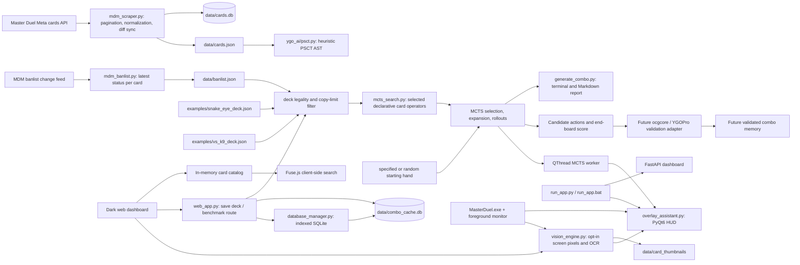

# System architecture

## Data and search flow

## Module boundaries

1. **Data ingestion** — the public cards endpoint supplies raw card records. The scraper normalizes the schema, deduplicates by stable card ID, stores records in SQLite (or optional PostgreSQL), and exports JSON. The MDM banlist change feed is stored separately as a latest-status snapshot and can be applied while loading a deck.
2. **PSCT interpretation** — the parser retains source text and extracts condition, cost, target, resolution, usage limit, timing, and common action verbs. This is heuristic parsing with confidence/manual-review flags; it is not a complete effect compiler.
3. **State and symbolic actions** — `ygo_ai/state.py` represents zones, positions, turn/phase fields, overlays, LIFO chains, basic Spell Speed legality and SEGOC trigger ordering. `mcts_search.py` uses a compact state and selected hand-authored Snake-Eye/Diabellstar and Vanquish Soul x K9 operators. The VS/K9 model tracks retained FIRE/DARK/EARTH reveal attributes, K9 Level 5 bodies, Rank 4/5 Xyz materials and Link materials. The parser output does not automatically execute arbitrary cards.
4. **MCTS and scoring** — selection/expansion explores modeled legal actions, rollouts apply weighted random actions, and backpropagation scores negates, interruptions, card advantage, ATK and deck resources. `generate_combo.py` exports the best sequence found for the supplied iteration budget and seed.
5. **Rules authority** — an ocgcore/YGOPro adapter is not included. Production legality, timing, summon restrictions, replacement effects and rulings must come from a pinned engine and card-script database. Candidate lines need replay validation before entering a combo memory bank.
6. **Local UI and vision** — `web_app.py` loads the catalog once in process memory, serves the Jinja dashboard, and runs route simulation in a worker thread. `database_manager.py` persists order-independent hand keys and keeps a human route as Gold when it ties or beats the MCTS score. `overlay_assistant.py` keeps MCTS and repeated vision scans off the UI thread, hides unless Master Duel is foreground, and can pivot from a replayed action prefix. `vision_engine.py` captures configured screen rectangles only while the game is foreground; local image templates and a Tesseract executable are needed for card/OCR results.

## Next integration steps

- Pin an ocgcore revision and card scripts, then expose legal actions and state transitions through a stable Python/native bridge.
- Compare model action lists and chain outcomes against engine replay logs.
- Replace the compact search state with engine observations before training a policy/value network or using self-play results as game strategy.
- Store only engine-validated lines with the deck, initial hand, engine/database versions, sequence and end-board features.

The current project provides a repeatable data sync, a banlist snapshotter, heuristic PSCT parsing, a minimum duel-state model, selective archetype simulators, and an MCTS combo exporter. It does not include a full Master Duel simulator, trained RL models, or universal card-effect interpretation.
